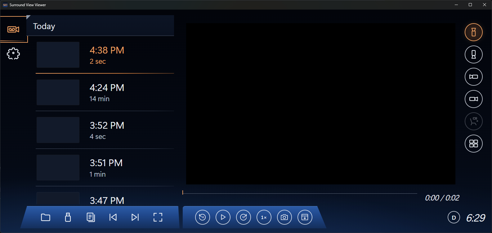

# Surround Vision Viewer

Watch the clips recorded by GM's **Surround Vision Recorder** on a computer, phone or tablet, in an interface modelled on the recordings screen inside the vehicle.

Newer GM vehicles built on the Ultifi platform (for example the Cadillac VISTIQ) can record all four exterior surround-view cameras to a USB flash drive. In the car you can review those clips on the center display, but on a computer you just get a folder of oddly named MP4s: four files per 5-minute chunk, with no way to tell which belong together. Surround Vision Viewer turns that folder back into the experience you get in the car: a list of recordings, a player that runs straight through the 5-minute chunks, and one-tap switching between cameras.

**[Open the web app →](https://pvcoco.github.io/Surround-Vision-Viewer/)** (Chrome or Edge recommended)

> Not affiliated with or endorsed by General Motors or Cadillac. "Surround Vision", "Cadillac", "VISTIQ" and "Ultifi" are trademarks of their respective owners.

---

## Contents

- [Features](#features)
- [How the recorder stores video](#how-the-recorder-stores-video)
- [Getting started](#getting-started)
- [Using the viewer](#using-the-viewer)
- [Browser and platform support](#browser-and-platform-support)
- [Privacy](#privacy)
- [How it works](#how-it-works)
- [Building and deploying](#building-and-deploying)
- [Troubleshooting](#troubleshooting)
- [License](#license)

## Features

- **Car-style interface**: dark glass look, amber accents, round camera buttons and the blue control bar, laid out like the in-vehicle recordings screen. On phones it rearranges into a portrait layout.
- **Recordings list** grouped by day ("Today", "Yesterday", dates), with a thumbnail, start time and length for each recording.
- **Seamless multi-segment playback**: the recorder's 5-minute pieces play back as one continuous recording with a single timeline (for example `2:55 / 14:08`). Segment boundaries show as small ticks.
- **Camera switching** between front, rear, left and right, staying at the same moment in time. A cabin camera is supported if the vehicle records one.
- **Four-up view** shows all four surround cameras at once, kept in sync.
- **Playback controls**: drag to scrub, jump ±10 s, speeds from 0.25× to 8×, full screen.
- **Export**: save a PNG snapshot of the current frame (or the full 2×2 grid), or save the original MP4 file for the current segment.
- **Finds the drive automatically** in the desktop app, whatever drive letter or mount point the flash drive gets, and notices when it's plugged in.
- **Runs anywhere**: a static web app (installable as a PWA, works offline) plus desktop builds for Windows, macOS and Linux from the same code.

## How the recorder stores video

The vehicle writes recordings to this folder on the flash drive:

```
<drive>/Android/media/com.gm.ultifi.gmconnectedcameraservice/Recordings/SurroundVisionRecorder/
```

Each camera gets its own file, named with the camera and the **local** start time:

```
FRONT_2026_10_12_T_16_24_10.mp4
REAR_2026_10_12_T_16_24_10.mp4
LEFT_2026_10_12_T_16_24_10.mp4
RIGHT_2026_10_12_T_16_24_10.mp4
```

Details observed on a 2026 VISTIQ:

| Property | Value |
| --- | --- |
| Container | MP4 (`moov` atom at the end of the file) |
| Video | H.264, 1280 × 768, no audio |
| Segment length | Up to 5 minutes; a new set of files starts every 5 minutes while recording |
| Size | Roughly 110 MB per camera per 5-minute segment |

### How recordings are grouped

The viewer reads each segment's real duration from its MP4 header. Back-to-back 5-minute segments (one ends exactly where the next begins) are always joined into a single recording, which matches the car's own grouping and duration.

The car also merges some recordings that have short gaps between them. That grouping seems to be based on drive sessions the vehicle tracks internally, which aren't written to the drive. To get similar results, set **Settings → Combine recordings** to merge recordings that are less than 1, 2, 5 or 15 minutes apart.

## Getting started

### Option 1: in a web browser

1. Go to the hosted app, or host it yourself (see [Building and deploying](#building-and-deploying)).
2. Plug the vehicle's flash drive into your computer.
3. Click **Open flash drive…** and choose the drive. You can pick the drive itself, the `SurroundVisionRecorder` folder, or any folder in between; the viewer finds the recordings.

In Chrome and Edge the viewer remembers the drive. Next time, click **Reconnect** to allow access again with one click.

You can also **drag the drive or folder** onto the window, or use **Pick video files…** to select MP4s directly (the best option on iPhone and iPad).

### Option 2: the desktop app

Build and run it from source (see [Packaging the desktop app](#packaging-the-desktop-app) for installers):

```sh
npm install
npm run electron
```

The desktop app searches all drives for the recorder folder when it starts, and again whenever a drive is connected or removed. You don't need to pick anything. If your recordings are copied somewhere else, use the folder button to choose that location; the app remembers it.

## Using the viewer



- **Left rail**: switch between the recordings list and settings.
- **Recordings list**: tap a recording to start playing it. The selected recording is shown in amber.
- **Player**: click the video to play or pause; double-click for full screen.
- **Camera buttons** (right column): switch camera without losing your place. The bottom button toggles the four-camera grid. Buttons are dimmed for cameras missing from that recording.
- **Timeline**: click or drag anywhere to jump; it covers the whole recording, across segments.
- **Left control bar**: open a drive or folder, rescan drives, pick individual files, previous/next recording, full screen.
- **Right control bar**: back 10 s, play/pause, forward 10 s, playback speed, save snapshot, save the original video file.
- **Status area**: the source drive (for example `D`) and the current time.

### Keyboard shortcuts

| Key | Action |
| --- | --- |
| `Space` / `K` | Play / pause |
| `←` / `→` | Back / forward 5 seconds (hold `Shift` for 30 s) |
| `J` / `L` | Back / forward 10 seconds |
| `↑` / `↓` | Newer / older recording |
| `1`–`5` | Front, rear, left, right, cabin camera |
| `Q` | Toggle four-camera view |
| `[` / `]` | Slower / faster |
| `Home` | Jump to the start |
| `S` | Save snapshot |
| `F` | Full screen |

### Settings

| Setting | Description |
| --- | --- |
| Combine recordings | Join only back-to-back segments (default), or also merge recordings less than 1, 2, 5 or 15 minutes apart. |
| Starting camera | Which camera is shown when you open a recording. |
| Continue to next recording | When a recording ends, play the next newer one. |
| 24-hour clock | Show times as 16:24 instead of 4:24 PM. |

## Browser and platform support

| Platform | How recordings are opened |
| --- | --- |
| Desktop app on Windows, macOS, Linux | Found automatically on any drive, or choose a folder |
| Chrome, Edge, Opera (desktop) | Choose the drive or folder; remembered between visits |
| Chrome on Android | Choose the drive or folder (USB-C / OTG flash drive) |
| Firefox (desktop) | Choose a folder, drag and drop, or pick files |
| Safari (macOS) | Choose a folder, drag and drop, or pick files |
| Safari on iPhone / iPad | Pick files from the Files app |

The recordings are standard H.264, so every modern browser plays them without plug-ins.

## Privacy

Recordings never leave your device. The web app is a set of static files; it reads the videos straight from your drive in the browser and makes no network requests with them. Nothing is uploaded, and there is no server-side code, analytics or tracking. The desktop app only reads the recorder folders it finds or that you choose.

Keep in mind that the recordings themselves may show house numbers, license plates, street signs and other identifying details. Take care before sharing snapshots or clips.

## How it works

The app is plain TypeScript with no runtime dependencies, bundled with [Vite](https://vitejs.dev). The web and desktop versions share all of the UI and playback code; they differ only in how they get at the files.

```
src/
  main.ts           UI: list, controls, settings, keyboard, drag & drop
  player.ts         Playback engine: one <video> per camera, segment stitching, sync
  recordings.ts     File-name parsing, grouping segments into recordings, formatting
  mp4.ts            Reads the duration from the MP4 header without loading the video
  thumbs.ts         Generates list thumbnails one at a time
  settings.ts       Saved preferences (localStorage)
  sources/web.ts    Browser file access: directory picker, folder input, drag & drop
  sources/native.ts Desktop file access through the Electron bridge
electron/
  main.cjs          Drive scanning, the svr:// file protocol, window management
  preload.cjs       Small, sandboxed API exposed to the UI
tests/              Unit tests (Vitest)
```

Some implementation notes:

- **Durations without decoding.** Opening ~100 MB files just to learn their length would be slow, so `mp4.ts` walks the MP4 box headers and reads only the `moov`/`mvhd` atom near the end of each file.
- **Instant camera switching.** The player keeps one `<video>` element per camera loaded with the current segment. Hidden cameras stay paused and are moved to the current time when you switch to them. In the four-up view, one camera acts as the clock and the others are corrected if they drift by more than a quarter second.
- **Seeking in the desktop app.** Recordings are served through a custom `svr://` protocol that supports HTTP range requests, so the player can jump anywhere without reading the whole file. The protocol only serves recorder files from folders the app found or that you chose.
- **Unresponsive drives.** On Windows the desktop app checks drive letters A–Z with a short timeout, so a disconnected network drive can't slow down detection.

## Building and deploying

Requires [Node.js](https://nodejs.org) 22 or newer.

```sh
npm install
npm run dev          # web version with live reload at http://localhost:5173
npm test             # unit tests
npm run build        # static web build in dist/
npm run electron     # build, then run the desktop app
```

### Hosting the web version

`dist/` is a fully static site and works from any sub-path, so you can host it anywhere: GitHub Pages, Netlify, Cloudflare Pages, Vercel, Amazon S3, or any web server. Use HTTPS, because browsers only allow folder access and installing the app on secure pages.

This repository includes a GitHub Actions workflow (`.github/workflows/pages.yml`) that tests, builds and publishes the site to GitHub Pages on every push to `main`.

### Packaging the desktop app

Builds use [electron-builder](https://www.electron.build); output goes to `release/`.

```sh
npm run dist:win     # Windows installer (NSIS) + portable .exe
npm run dist:mac     # macOS .dmg (must be built on a Mac)
npm run dist:linux   # Linux AppImage + .deb
```

The builds aren't code-signed, so Windows SmartScreen and macOS Gatekeeper will warn the first time you open them.

## Troubleshooting

**"No Surround Vision recordings found."** Make sure the drive has the `Android/media/com.gm.ultifi.gmconnectedcameraservice/Recordings/SurroundVisionRecorder` folder with files named like `FRONT_2026_10_12_T_16_24_10.mp4`. If you renamed or moved the files, use **Pick video files…** and select them directly; only the file names matter.

**The desktop app doesn't see the drive.** Click the drive (rescan) button in the left control bar, or choose the folder manually with the folder button. On Linux, make sure the drive is mounted.

**Chrome asks for permission again.** Browsers only remember folder access until the tab is closed; click **Reconnect** to allow it again.

**Times look wrong.** File names use the vehicle's local time, and the viewer shows them as-is, so they match what the car showed even if your computer is in a different time zone.

**A recording looks split into several entries.** See [How recordings are grouped](#how-recordings-are-grouped) and adjust **Settings → Combine recordings**.

## License

[MIT](LICENSE) © Patrick Coco
